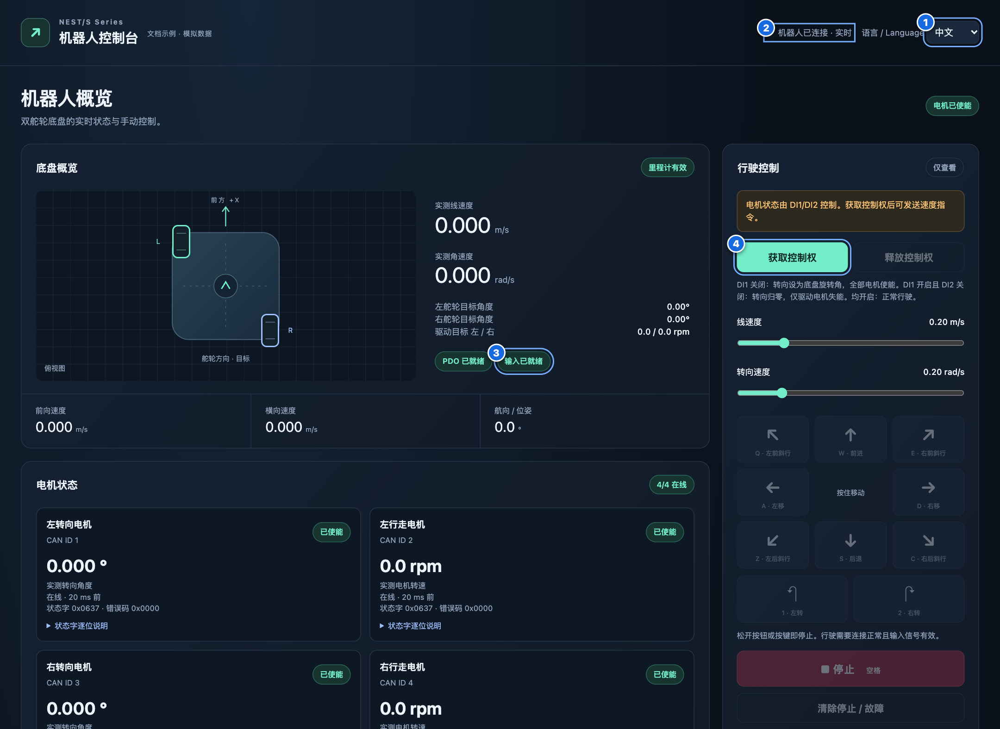
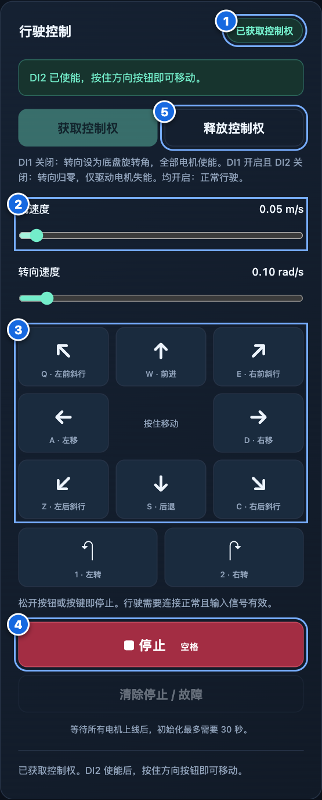
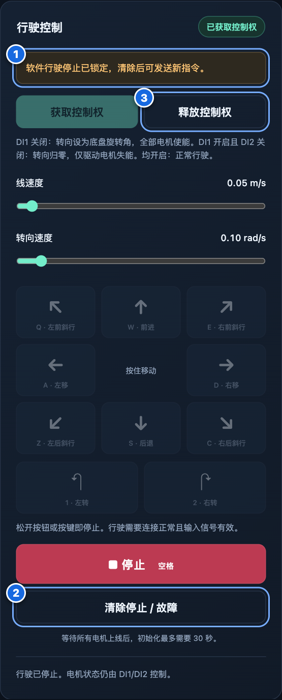
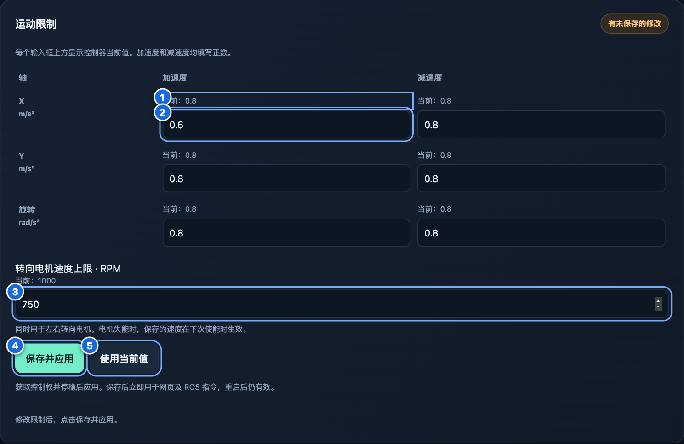
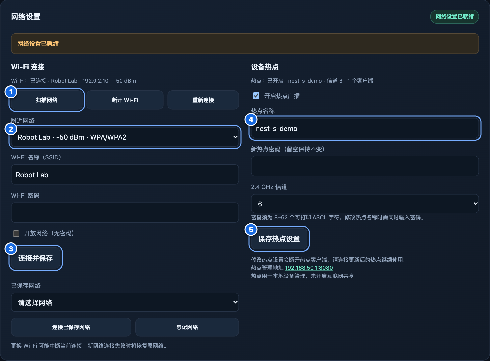

<div align="center">

[English](../../README.md) · **简体中文**

</div>

# RK3506 移动底盘 ROS 2 SDK

本 SDK 用于将 RK3506 禾利时双舵轮移动底盘接入 ROS 2。SDK 运行在上位机，
通过 UDP 与 RK3506 上独立运行的控制器通信。

C++ ROS 包名为 `rk3506_driver`。控制器程序位于独立的
`rk3506-can-interface-cpp` 仓库。已执行的检查及尚未完成的实车验收见
[验证报告](../VALIDATION.md)。

## 支持平台

| ROS 2 发行版 | 操作系统 | 架构 |
| --- | --- | --- |
| Humble | Ubuntu 22.04 | ARM64、x86_64 |
| Jazzy | Ubuntu 24.04 | ARM64、x86_64 |

四种组合均已通过构建和集成检查。ARM64 在原生架构 Docker 容器中验证，
x86_64 使用仿真运行。实车验收尚未完成。

## 使用条件

- 上位机已安装对应版本的 ROS 2、支持 C++17 的编译器、`colcon`，并完成
  `rosdep` 配置。
- 上位机能访问控制器的 UDP 端口：`5003` 用于底盘指令与状态，`5001` 用于
  电池，`5002` 用于数字输入。网络也需要允许控制器向上位机返回 UDP 数据。
- 控制器已安装配套的远程导航访问与浏览器控制权切换更新，详见
  [控制器集成说明](../CONTROLLER_INTEGRATION.md)。

控制器的 `--navigation-peer` 应设置为**控制器实际看到的上位机源 IPv4 地址**。
控制器启动脚本通过 `NAVIGATION_PEER` 接收此设置，部署时应写入服务环境以便
重启后保留。本地浏览器桥接程序继续使用 `--control-peer 127.0.0.1`。

SDK 的 `robot_ip` 则是**控制器的地址**。安装 ROS 包不会自动部署或配置控制器
更新。原先仅允许回环地址控制的版本，即使可以接收遥测，也会拒绝远程运动指令。

## 构建

将本仓库放在 `~/rk3506_ros2_ws/src/rk3506-mobile-base-ros2-sdk`，
然后在工作空间根目录构建：

```bash
mkdir -p ~/rk3506_ros2_ws/src
cd ~/rk3506_ros2_ws
source /opt/ros/humble/setup.bash
rosdep install --from-paths src --ignore-src -r -y
colcon build --packages-select rk3506_driver
source install/setup.bash
```

在 Ubuntu 24.04 上使用 Jazzy 时，将环境文件改为 `/opt/ros/jazzy/setup.bash`。
不同发行版应使用各自的工作空间与终端环境。`rosdep` 根据
[package.xml](../../rk3506_driver/package.xml) 安装依赖。

## 配置与启动

将提供的配置模板复制到安装目录之外，便于维护：

```bash
cd ~/rk3506_ros2_ws
cp src/rk3506-mobile-base-ros2-sdk/rk3506_driver/config/driver.yaml ./rk3506-driver.yaml
```

将 `robot_ip` 改为可访问的控制器 IPv4 地址，检查坐标系、速度上限和超时时间，
然后启动：

```bash
source install/setup.bash
ros2 launch rk3506_driver driver.launch.py params_file:="$PWD/rk3506-driver.yaml"
```

模板默认地址为 `192.168.50.1`。驱动参数在启动后均为只读；修改 YAML 后需要
重启节点才能生效。节点默认名称为 `rk3506_driver`。指定命名空间的示例：

```bash
ros2 launch rk3506_driver driver.launch.py \
  params_file:="$PWD/rk3506-driver.yaml" namespace:=robot1
```

YAML 使用 `/**`，因此也适用于带命名空间的节点。上述接口名称将变为
`/robot1/cmd_vel`、`/robot1/wheel/odometry`、`/robot1/stop` 等。

也可以直接运行节点并重映射话题：

```bash
ros2 run rk3506_driver rk3506_driver_node --ros-args \
  --params-file "$PWD/rk3506-driver.yaml" -r cmd_vel:=/navigation/cmd_vel
```

## 使用方法

每个命令行终端都需要加载 ROS 环境和工作空间环境。完成现场监督下的
[实车检查清单](../ROBOT_CHECKLIST.md)、确认允许运动后，应用直接发布底盘速度
即可，SDK 在内部管理控制会话。SDK 不提供显式申请/释放控制权、电机使能或
故障清除服务。

默认使用 Twist 输入。以下示例以 20 Hz 请求低速前进：

```bash
ros2 topic pub --rate 20 /cmd_vel geometry_msgs/msg/Twist \
  '{linear: {x: 0.05, y: 0.0}, angular: {z: 0.0}}'
```

`linear.x` 和 `linear.y` 是车体坐标系下的线速度，单位 m/s；`angular.z` 是
偏航角速度，单位 rad/s。按 Ctrl+C 停止发布。指令超时默认为 300 ms，可通过
参数配置；超时后 SDK 请求零速度，由控制器执行减速。这不是实车停止时间保证。

如需带时间戳的输入，在 YAML 中设置 `use_stamped_cmd_vel: true` 并重启。
ROS CLI 会在每次发布时刷新 `stamp: now`：

```bash
ros2 topic pub --rate 20 /cmd_vel geometry_msgs/msg/TwistStamped \
  '{header: {stamp: now, frame_id: base_link}, twist: {linear: {x: 0.05}, angular: {z: 0.0}}}'
```

坐标系填写配置的 `base_frame`，也可以留空。发布端与驱动应使用对齐的 ROS
时钟。任一时刻只启用一种输入消息类型。

按需在不同终端查看反馈：

```bash
ros2 topic echo /wheel/odometry
ros2 topic echo /battery_state
ros2 topic echo /digital_inputs
ros2 topic echo /diagnostics
```

请求软件停止：

```bash
ros2 service call /stop std_srvs/srv/Trigger '{}'
```

`success: true` 表示控制器已确认停止请求。如果请求被拒绝、控制权属于其他
来源、控制器不可用或未收到确认，则返回 `success: false` 及原因说明。
该返回值不能证明机器人已在物理上完全停止。

软件停止会锁存。先停止速度发布，再通过现有 Web 界面显式清除。
DI1/DI2 始终保留电机使能权限，SDK 不会自动清除停止或故障状态。

## Web 界面

控制器提供 Web 界面，用于查看状态、手动驾驶和修改设置。它由 RK3506 上的
`robot-web` 提供；启动 ROS 节点不会启动 Web 服务。

下面使用真实控制台页面和模拟遥测数据演示操作。数字标出对应控件，图中的数值仅作示例。

### 1. 打开控制台并检查就绪状态

1. 将电脑或手机连接到控制器所在的局域网、控制器热点，或已配置的 ZeroTier 网络。
2. 打开 `http://<controller-ip>:8080/`。通过控制器热点连接时，默认地址为
   `http://192.168.50.1:8080/`。如果修改过 `WEB_PORT`，请使用实际端口。
3. 在页面顶部选择 **中文 / English**。新浏览器默认使用中文，语言选择会保存在本地。



| 图中编号 | 检查或操作 |
| --- | --- |
| **1** | 选择界面语言。 |
| **2** | 确认显示 **机器人已连接 · 实时**。 |
| **3** | 行驶前确认 **输入已就绪**，且反馈有效。 |
| **4** | 点击 **获取控制权**，进入手动操作。 |

仅查看状态不会申请速度控制权。操作前请检查底盘状态、轮式里程计、电池、
DI1–DI8、电机反馈和系统状态。无效或过期测量不会显示为当前有效值。
底盘概览中的转向/驱动目标与电机面板中的实测值是不同的数据。

### 2. 获取控制权并驾驶

请求实车运动前，请完成[实车检查清单](../ROBOT_CHECKLIST.md)。
行驶需要 DI1 急停释放、DI2 接通且反馈有效；网页不提供电机使能/失能按钮。

点击上方概览图中的 **获取控制权**。安装配套控制权切换更新后，此操作会停止
ROS 运动；浏览器持有控制权期间，收到的 ROS 指令会被丢弃。成功后面板如下：



| 图中编号 | 操作 |
| --- | --- |
| **1** | 等待显示 **已获取控制权**，方向按钮可用。 |
| **2** | 将线速度和转向速度滑块设为合适的低速值。 |
| **3** | **按住**方向按钮移动；松开即清除保持的运动指令。 |
| **4** | 点击 **停止** 或按 **空格**，锁存软件停止。 |
| **5** | 手动操作结束后点击 **释放控制权**。 |

页面获得焦点、且没有在编辑表单时，也可以按住以下按键驾驶：

| 按键 | 按住时的运动 |
| --- | --- |
| **W / S** | 前进 / 后退 |
| **A / D** | 向左 / 向右平移 |
| **Q / E** | 左前 / 右前斜行 |
| **Z / C** | 左后 / 右后斜行 |
| **1 / 2** | 左转 / 右转 |

网页速度滑块仅用于手动指令。ROS 指令速度上限通过 SDK 的
`max_linear_velocity` 和 `max_angular_velocity` 参数配置。

### 3. 停止、恢复并切回 ROS

点击 **停止** 后，方向按钮会禁用，面板提示停止原因：



| 图中编号 | 操作 |
| --- | --- |
| **1** | 阅读停止/故障提示。松开停止按钮不会解除软件停止锁存。 |
| **2** | 先停止 ROS 速度发布器、排除故障原因，再在准备恢复时显式点击 **清除停止 / 故障**。 |
| **3** | 点击 **释放控制权** 结束浏览器控制。控制器就绪后，收到新 ROS 指令才会恢复导航。 |

如果软件停止仍在锁存，释放控制权后 ROS 也不能驱动底盘。停止状态清除后，
仍在运行的 ROS 发布器可能在浏览器释放控制权后立即恢复运动；如果不希望继续
导航，请保持发布器停止。整个过程中电机模式始终由 DI1/DI2 决定。

### 4. 保存运动设置

支持此功能的控制器版本会在 **运动限制** 面板显示当前 X/Y/偏航轴的加减速度，
以及两个转向电机共用的速度上限。获取控制权、停止底盘并等待有效静止反馈后，
编辑数值并点击 **保存并应用**。无需将 DI2 关闭。



| 图中编号 | 操作 |
| --- | --- |
| **1** | 查看每个输入框上方的控制器当前值。 |
| **2** | 编辑需要的加速度/减速度正数幅值。 |
| **3** | 如果控制器支持，设置两个转向电机共用的 RPM 上限。 |
| **4** | 点击 **保存并应用**，等待显示 **已保存并应用，重启后仍有效**。 |
| **5** | 点击 **使用当前值**，丢弃尚未保存的编辑。 |

加速度和减速度均填写正数：X/Y 单位为 m/s²，偏航轴单位为 rad/s²。
转向速度是电机轴转速 RPM，与底盘偏航角速度不同。保存的设置写入控制器配置，
重启后保留；加减速度同时作用于网页和 ROS 指令，不需要重启 SDK。
**使用当前值** 会丢弃尚未保存的编辑。如果保存超时，请先刷新当前值再重试；
如果提示转向速度已保存但未确认生效，请先检查并排除控制器报告的故障，再显式清除。

### 5. 配置 Wi-Fi 或设备热点

在 **网络设置** 中可扫描、连接并保存 Wi-Fi 网络，也可修改控制器热点的 SSID、
密码和信道。无需将 DI2 关闭；其他浏览器持有控制权时不能修改网络设置。



| 图中编号 | 操作 |
| --- | --- |
| **1** | 点击 **扫描网络**。 |
| **2** | 选择附近网络，或手动填写 SSID，再在下方输入 Wi-Fi 密码。 |
| **3** | 点击 **连接并保存**，等待界面更新连接状态和 IP。 |
| **4** | 如需修改设备热点，在右侧编辑名称、密码和信道。 |
| **5** | 点击 **保存热点设置**，必要时重新连接热点。 |

热点密码留空表示保持不变；修改热点名称时需要重新输入密码。
已保存的 Wi-Fi 可以通过 **连接已保存网络** 切换。

修改连接前请停止速度发布器。网络变更可能中断网页连接及 ROS UDP 通信。
如果控制器地址改变，请使用新地址重新连接，修改 `robot_ip` 并重启 SDK。
如果上位机源 IP 改变，还需要更新控制器的 `NAVIGATION_PEER`。

## 浏览器控制与重连

浏览器控制优先。浏览器持有控制权期间收到的 ROS 指令会被丢弃。
浏览器释放控制权后，只有新收到的 ROS 速度指令才能自动恢复导航。
因此，如果 ROS 发布器仍在运行，导航可能立即恢复；如果不希望继续运动，
请先停止发布器，再释放浏览器控制权。

节点启动本身不会请求运动。检测到通信中断后，SDK 会自动恢复遥测订阅，
并丢弃缓存速度；恢复运动需要新的 ROS 指令。控制器自身的看门狗和物理
电机联锁始终有效。

## ROS 接口

除标准话题 `/tf` 外，以下名称均相对于节点命名空间。

| 接口 | ROS 类型 | 默认行为 |
| --- | --- | --- |
| `cmd_vel` | `geometry_msgs/msg/Twist` | 通过 `use_stamped_cmd_vel` 可改用 `TwistStamped`，只启用一种类型 |
| `wheel/odometry` | `nav_msgs/msg/Odometry` | 仅发布控制器有效的位姿与车体速度 |
| `battery_state` | `sensor_msgs/msg/BatteryState` | 仅发布有效电池数据 |
| `digital_inputs` | `std_msgs/msg/UInt8` | DI1–DI8 有效输入位掩码 |
| `diagnostics` | `diagnostic_msgs/msg/DiagnosticArray` | 标志位、健康状态、控制权和 UDP 接收数据年龄 |
| `stop` | `std_srvs/srv/Trigger` | 返回控制器确认、拒绝或超时结果 |
| `/tf` | `tf2_msgs/msg/TFMessage` | 可选的里程计到车体坐标变换，默认关闭 |

`cmd_vel` 为订阅话题，遥测与 TF 为发布话题，`stop` 为服务。
`digital_inputs` 的 bit0–bit7 分别对应 DI1–DI8。

`TwistStamped` 必须使用当前 ROS 时钟的有效非零时间戳，坐标系应为空或等于
配置的车体坐标系。时间戳与当前时间的差不能超过 `command_timeout`，无论
过期还是超前。平面运动指令必须为有限数值且不超过配置上限，线速度 Z 和
角速度 X/Y 必须为零。无效指令会清除 SDK 的目标速度。

## 参数

所有时长单位均为秒。各 UDP 端口必须互不相同，范围为 `1..65535`。

| 参数 | 默认值 | 含义 |
| --- | --- | --- |
| `robot_ip` | `192.168.50.1` | 控制器 IPv4 地址，不接受主机名 |
| `base_port` | `5003` | 底盘指令与状态 UDP 端口 |
| `battery_port` | `5001` | 电池 UDP 端口 |
| `di_port` | `5002` | 数字输入 UDP 端口 |
| `command_timeout` | `0.3` | 已接收指令的超时阈值及带时间戳输入的时间差上限 |
| `base_timeout` | `0.5` | 底盘 UDP 接收数据年龄阈值 |
| `battery_timeout` | `6.0` | 电池 UDP 接收数据年龄阈值 |
| `di_timeout` | `1.0` | 数字输入 UDP 接收数据年龄阈值 |
| `max_linear_velocity` | `1.0` | X/Y 各轴线速度绝对值上限，单位 m/s |
| `max_angular_velocity` | `1.0` | 偏航角速度绝对值上限，单位 rad/s |
| `use_stamped_cmd_vel` | `false` | 使用 TwistStamped 替代 Twist |
| `publish_tf` | `false` | 发布里程计到车体坐标变换 |
| `odom_frame` | `odom` | 轮式里程计父坐标系 |
| `base_frame` | `base_link` | 车体坐标系，同时为里程计子坐标系 |
| `pose_covariance` | `[0.1, 0.1, 1000000.0, 1000000.0, 1000000.0, 0.2]` | 位姿协方差的六个对角项 |
| `twist_covariance` | `[0.1, 0.1, 1000000.0, 1000000.0, 1000000.0, 0.2]` | 速度协方差的六个对角项 |

协方差按 X、Y、Z、roll、pitch、yaw 排列，必须是有限且非负的数值。
默认值未经实测标定。坐标系名称必须非空、互不相同且不能以 `/` 开头。
超时和速度上限必须为有限正数；速度上限不能超过协议范围 `32.767`。

可编辑的配置模板：[driver.yaml](../../rk3506_driver/config/driver.yaml)。

## 里程计与导航集成

轮式里程计来自控制器，SDK 不会再次积分运动。传感器融合和定位在上位机完成。

TF 默认关闭。仅在没有其他估计器发布对应里程计到车体坐标变换时，才启用
`publish_tf`。协方差默认值未经标定，可按实际情况配置。接入导航栈时，
绕过上游速度平滑器，将经过碰撞检查的车体速度输出重映射到本节点的
`cmd_vel`；保留碰撞检查，由控制器统一负责速度平滑。

遥测使用 ROS 接收时间。缺失或无效测量不会发布，诊断会报告失败或超时。
缓存的电池或输入数据不能证明源测量的采集时间。电池电流沿用 BMS 的有符号
电流约定，温度为电池包 NTC 温度均值；无法获得的单体电压及设计容量使用
NaN。不提供源时钟同步保证。

控制器采集进程重启后，轮式里程计原点会重置。V1 不拼接重启前后的位姿，
也不保证检测到每次重启。确认采集进程重启后，应恢复上位机估计器。

## 诊断与故障排查

诊断包含控制器标志位、控制会话、指令年龄、传感器健康状态、异常报文计数
及接收数据年龄。近期未收到数据为 `STALE`；测量失败或控制器故障/软件停止
锁存为 `ERROR`；运动受限、控制权属于其他来源或使用仿真控制器为 `WARN`。

| 现象 | 检查项 |
| --- | --- |
| 找不到 ROS 包 | 构建工作空间，并在当前终端加载 `install/setup.bash` |
| 没有遥测或诊断显示过期 | 检查控制器 IP、UDP 端口、路由、返回流量及控制器服务 |
| 有遥测但运动指令无效 | 检查配套控制器更新、导航来源 IP、DI1/DI2、锁存故障/停止及浏览器控制权 |
| `cmd_vel` 没有匹配的订阅者 | 检查命名空间、重映射及 Twist/TwistStamped 类型选择 |
| 带时间戳指令被拒绝 | 检查时间戳、时钟对齐及车体坐标系 |
| 参数修改被拒绝 | 参数为只读，编辑 YAML 后重启节点 |
| 里程计 TF 重复 | 对同一里程计到车体坐标变换只保留一个发布者 |

## 测试

在已完成构建的 ROS 工作空间中运行：

```bash
colcon test --packages-select rk3506_driver --event-handlers console_direct+
colcon test-result --verbose
```

13 个集成测试用例运行真实节点，通过回环 UDP 和独立 ROS 域连接模拟控制器，
覆盖指令转发、超时、控制权切换、重连、停止结果、遥测、无效输入、带时间戳
指令、可选 TF 和启动参数。测试不会访问实车。

在仓库根目录，可通过现有 ROS 容器重复执行隔离验证：

```bash
tools/validate-container.sh ros2-humble-dev humble
tools/validate-container.sh ros2-jazzy-dev jazzy
```

脚本需要 Docker，以及已运行、已安装对应 ROS 发行版和依赖的容器。
它会创建临时工作空间并执行普通复制安装，不影响其他工作空间。
日志和 XML 结果保存在被 Git 忽略的 `artifacts/` 目录。

## 设计文档

- [实车验收检查清单](../ROBOT_CHECKLIST.md)
- [控制器访问与浏览器集成](../CONTROLLER_INTEGRATION.md)
- [V1 设计](../ROS2_SDK_DESIGN.md)
- [实现规格](../IMPLEMENTATION_SPEC.md)
- [规格议题 #1](https://github.com/bot-lin/rk3506-mobile-base-ros2-sdk/issues/1)
- [V1 实现议题 #2](https://github.com/bot-lin/rk3506-mobile-base-ros2-sdk/issues/2)
- [领域术语表](../../CONTEXT.md)
- [架构决策](../adr/0001-ros-sdk-boundary-and-initial-scope.md)
